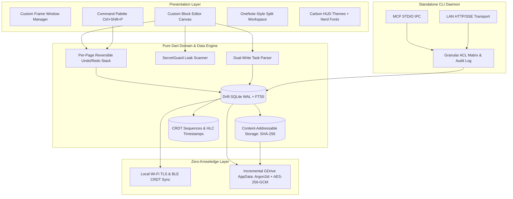

<div align="center">

# ⚡ Nodus

**The Sovereign, Local-First Technical Workspace & Note-Taking Engine**

*Built for Software Engineers, Network Architects, DevOps/SREs, and Cybersecurity Professionals.*

[](https://flutter.dev)
[](https://dart.dev)
[](https://drift.simonbinder.eu/)
[-blueviolet)](https://modelcontextprotocol.io/)
[](https://en.wikipedia.org/wiki/Advanced_Encryption_Standard)
[](https://flutter.dev/multi-platform)
[](./LICENSE)

<br/>

[**Explore Specifications**](./docs/SPECIFICATION.md) • [**Phase 1 Plan (TDD)**](./docs/IMPLEMENTATION_PLAN.md) • [**Master TODO**](./docs/TODO.md) • [**Architecture**](#-system-architecture) • [**Core Features**](#-core-features) • [**Getting Started**](#-getting-started)

</div>

---

## 📖 About Nodus

Traditional note-taking tools force a compromise: either you settle for locked-in, cloud-hosted SaaS platforms that expose your proprietary code and infrastructure secrets to third-party databases, or you rely on disconnected text files that lack hierarchical organization, deep search, and intelligent tooling.

**Nodus** (*Latin for node, connection, or intersection*) delivers an uncompromising, developer-first alternative:

* **Sovereign & Local-First:** Your data is stored strictly on your local NVMe/SSD inside a high-speed SQLite database with WAL mode and Content-Addressable Storage (CAS). Zero mandatory cloud infrastructure.
* **Hierarchical Organization:** OneNote-inspired structure (`Notebooks` ➔ `Sections` ➔ `Pages` ➔ `Subpages`) paired with resizable split-view panes.
* **Developer Ergonomics:** Custom block editor built from scratch on Flutter's text engine, rendering ANSI 256-color terminal logs, syntax-highlighted code blocks with Smart Copy (auto-stripping shell prompt prefixes like `$ ` and `# `), and a Zed/VS Code-style command palette (`Ctrl+Shift+P`).
* **Active SecretGuard Protection:** Real-time heuristic scanning detects AWS keys, GitHub tokens, and private keys as you type, offering instant one-click redaction or client-side vault encryption.
* **First-Class AI Context via MCP:** Ships with a standalone headless CLI daemon (`nodus-mcp-server`) that enables Claude Desktop, Cursor, Antigravity, and local LLMs to securely query and edit notes with granular notebook/section-level access control.
* **Zero-Knowledge Cloud Backup & P2P Sync:** WhatsApp-style encrypted synchronization: direct device-to-device CRDT exchange over local Wi-Fi/BLE, backed by client-side encrypted incremental backups to Google Drive AppData (`Argon2id` + `AES-256-GCM`).

---

## ✨ Core Features

| Feature | Description |
|---|---|
| **🧱 Custom Block Editor** | Purpose-built block canvas powered by Flutter `EditableText` controllers. Polymorphic Freezed sealed blocks, slash commands (`/code`, `/term`, `/task`, `/vault`), fractional reordering, and per-page undo/redo command history. |
| **💻 ANSI Terminal & Code Engine** | Full ANSI escape code engine rendering live terminal outputs (`nmap`, `curl -v`, `pytest`, `docker build`) with exit-code badges (`Exit 0`, `Exit 137`) alongside multi-language syntax highlighting. |
| **🛡️ SecretGuard** | Debounced heuristic regex scanner that inspects dirty blocks for API keys, SSH keys, and JWTs, giving engineers active leak prevention. |
| **⚡ Sub-Millisecond Search** | SQLite **FTS5** virtual table with weighted BM25 ranking (`title` 5.0x, `tags` 3.0x, `content` 1.0x) indexing tens of thousands of notes in fractions of a millisecond. |
| **💾 Content-Addressable Storage (CAS)** | Large binary attachments, packet captures (`.pcap`), and architecture diagrams are deduplicated by SHA-256 hash in `.nodus/blobs/`, keeping SQLite lightning-fast. |
| **🎨 "Carbon HUD" Theming** | 12 high-contrast dark and light themes (Hack The Box default, Tokyo Night, Catppuccin, Dracula, Nord, GitHub Light) paired with **Fira Code Nerd Font** ligatures. |
| **🪟 Platform-Adaptive Window** | Frameless custom window chrome with breadcrumbs and theme-integrated controls on Linux, macOS, and Windows. |
| **🤖 Model Context Protocol (MCP)** | Independent Dart CLI server (`nodus-mcp-server`) exposing STDIO & LAN HTTP/SSE transports with bearer token authentication and tamper-evident audit logging. |
| **✅ Dual-Write Task & Productivity Engine** | Natural inline task syntax (`- [ ] Task @due(2026-11-01) @priority(high)`) dual-written on save to relational SQLite tables, with upcoming **Kanban Board**, **Gantt Chart**, and **Multi-Format Export** views. |

---

## 🏛 System Architecture

Nodus is architected as a **modular Dart monorepo workspace** enforcing strict Clean Architecture boundaries:

```
nodus/                               # Root Monorepo (Flutter GUI Application)
├── packages/
│   ├── nodus_core/                  # Pure Dart Package (Zero Flutter UI dependencies)
│   │   ├── lib/domain/              # Entities, Freezed Sealed Blocks, Repository Contracts
│   │   ├── lib/data/                # Drift SQLite DB, DAOs, CAS Blob Engine, FTS5 Search
│   │   └── lib/usecases/            # Use Cases, SecretGuard Scanner, Dual-Write Task Parser
│   └── nodus_mcp/                   # Standalone Dart CLI Executable (nodus-mcp-server)
│       ├── bin/nodus_mcp_server.dart# STDIO IPC & Authenticated LAN HTTP/SSE Transports
│       └── lib/acl/                 # Notebook / Section RBAC & Audit Log Engine
├── lib/                             # Flutter Presentation Layer
│   ├── core/                        # Dependency Injection, Window Management, Themes
│   └── features/                    # Custom Block Canvas, Split HUD Views, Command Palette
└── test/                            # Comprehensive Unit, Widget, Golden & Integration Suites
```



---

## 🎨 Curated Themes

Designed for prolonged terminal sessions and high optical comfort:

| Dark Themes (High-Density "Carbon HUD") | Light Themes (Precision Daylight) |
|---|---|
| 🟢 **Hack The Box** *(Default - Deep slate, terminal neon green)* | 📄 **GitHub Light / Primer** *(Ultra-crisp engineering paper)* |
| 🌌 **Tokyo Night** *(Deep blue-indigo night sky)* | ☕ **Catppuccin Latte** *(Warm, soothing pastel light)* |
| ⚛️ **One Dark Pro** *(Balanced Atom / VS Code palette)* | ☀️ **Tokyo Night Day** *(Cobalt and violet accents)* |
| ☕ **Catppuccin Mocha** *(High-contrast pastel dark)* | 📜 **Solarized Light** *(Precision-tuned optical contrast)* |
| 🧛 **Dracula** *(Vibrant Gothic purple and cyan)* | 💡 **One Light** *(Clean daylight Atom theme)* |
| ❄️ **Nord** *(Arctic blue-gray aesthetic)* | |
| 🪵 **Gruvbox Dark** *(Retro groove warm contrast)* | |

---

## 🚀 Getting Started

### Prerequisites

* [Flutter SDK](https://docs.flutter.dev/get-started/install) (`^3.19` or later, Dart `^3.3`)
* C/C++ compiler toolchain (for native SQLite support and desktop builds):
  * **Linux:** `sudo apt install clang cmake ninja-build pkg-config libgtk-3-dev libsqlite3-dev`
  * **macOS:** Xcode & Command Line Tools
  * **Windows:** Visual Studio 2022 (with "Desktop development with C++")

### Installation & Local Setup

```bash
# 1. Clone the repository
git clone https://github.com/subhn23/nodus.git
cd nodus

# 2. Fetch dependencies
flutter pub get

# 3. Run code generation (Freezed, Drift, Injectable)
dart run build_runner build --delete-conflicting-outputs

# 4. Run the test suite
flutter test
```

### Running the Application

```bash
# Launch on Linux Desktop
flutter run -d linux

# Launch on macOS Desktop
flutter run -d macos

# Launch on Windows Desktop
flutter run -d windows

# Launch on connected Android device / emulator
flutter run -d android
```

---

## 🗺️ Project Roadmap & Phase Deliverables

* **Phase 1: Core Foundation & Custom Block Editor (Current)**
  * [x] Complete technical specifications and architectural sign-off.
  * [x] TDD implementation roadmap with 9 decomposed milestones.
  * [ ] Dart workspace monorepo scaffolding (`nodus_core`, `nodus_mcp`).
  * [ ] "Carbon HUD" Theme Engine & Nerd Font integration with Golden Tests.
  * [ ] Drift SQLite WAL database with CRDT-ready schema and FTS5 search.
  * [ ] Custom block editor canvas (`EditableText`), slash commands, and undo/redo command stack.
  * [ ] Smart Copy code blocks and ANSI 256-color terminal logs.
  * [ ] SecretGuard active heuristic scanner.
  * [ ] Content-Addressable Storage (CAS) with isolate-backed image compression.
  * [ ] Comprehensive end-to-end integration test suite.

* **Phase 2: Headless MCP Server & Productivity Views**
  * [ ] Standalone `nodus-mcp-server` CLI binary distribution (STDIO + HTTP/SSE).
  * [ ] Interactive **Kanban Board View** with drag-and-drop status transitions.
  * [ ] Interactive **Gantt Chart & Timeline View** with `@depends_on` dependency tracking.
  * [ ] Project Export Engine: Mermaid Gantt syntax (`gantt`), iCalendar (`.ics`), CSV, and JSON.

* **Phase 3: Decentralized Sync & Zero-Knowledge Cloud Backup**
  * [ ] P2P device discovery via BLE / QR code handshake and local Wi-Fi TLS CRDT sync.
  * [ ] Zero-knowledge client-side encrypted Google Drive AppData backup with GFS manifest rotation.

---

## 📚 Detailed Documentation

* 📄 **[Technical Specification & Architecture (SPECIFICATION.md)](./docs/SPECIFICATION.md)** — In-depth breakdown of data models, database schema, CAS deduplication, MCP protocol, and encryption algorithms.
* 📋 **[Phase 1 Implementation Plan (IMPLEMENTATION_PLAN.md)](./docs/IMPLEMENTATION_PLAN.md)** — Test-Driven Development (TDD) milestones, test suites, and step-by-step verification flows.
* 📝 **[Master Project TODO & Progress Tracker (TODO.md)](./docs/TODO.md)** — Granular phase-wise task lists with interactive checklists covering all 20 project milestones.

---

## 📄 License

Licensed under the [Apache License, Version 2.0](./LICENSE) or AGPL-3.0. See the documentation for licensing details.
