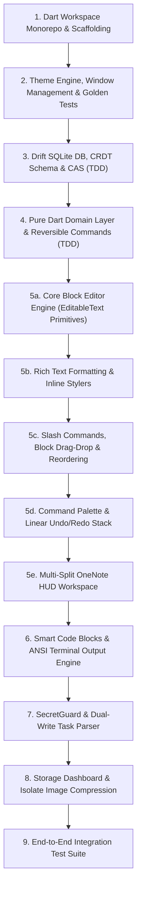

# Nodus — Phase 1 Implementation Plan (TDD First)

> **Documentation Standard:**  
> All architectural notes, plans, research, and documentation must **always** reside within the organized [`docs/`](./docs) folder in the project root.

This plan details the step-by-step Test-Driven Development (TDD) execution strategy for **Phase 1: Core Foundation, Custom Block Editor & Technical Workspace MVP**, fully updated to align with the architectural grill-me review.

---

## 🗺️ Milestone Roadmap Overview



---

### Step 1: Dart Monorepo Workspace & Scaffolding
* **Objective:** Establish the modular workspace separating pure Dart business logic from the Flutter presentation layer, paving the way for the headless MCP CLI daemon.
* **Workspace Structure:**
  ```
  nodus/
  ├── pubspec.yaml                     # Root workspace pubspec
  ├── packages/
  │   ├── nodus_core/                  # Pure Dart package (No Flutter dependencies)
  │   │   ├── pubspec.yaml             # drift, sqlite3, crypto, path, rfc_5545, uuid
  │   │   ├── lib/
  │   │   │   ├── domain/              # Entities, Value Objects, Repository Interfaces
  │   │   │   ├── data/                # Drift DB, DAOs, CAS Blob Engine, FTS5 Search
  │   │   │   └── usecases/            # CRUD, SecretGuard Scanner, Task Parser
  │   │   └── test/
  │   └── nodus_mcp/                   # Standalone Dart CLI
  │       ├── pubspec.yaml             # args, shelf, shelf_router, nodus_core
  │       └── bin/nodus_mcp_server.dart
  └── lib/                             # Flutter GUI Application (imports nodus_core)
      ├── core/                        # DI (get_it), ThemeExtension, Window Manager
      └── features/                    # Custom Editor Canvas, BLoCs, HUD Split Views
  ```
* **Dependencies:**
  * **nodus_core:** `drift`, `sqlite3`, `crypto`, `equatable`, `freezed_annotation`, `json_annotation`, `uuid`
  * **nodus (root):** `flutter_bloc`, `bloc`, `get_it`, `injectable`, `window_manager`, `multi_split_view`, `google_fonts`, `flutter_svg`, `flutter_secure_storage`, `image`
  * **Dev / Test:** `build_runner`, `drift_dev`, `freezed`, `json_serializable`, `injectable_generator`, `bloc_test`, `mocktail`, `flutter_test`, `integration_test`

---

### Step 2: "Carbon HUD" Theme Engine, Window Management & Golden Tests
* **Objective:** Provide the developer-centric dark/light aesthetics, custom window frame on desktop, and typography.
* **TDD Strategy:**
  * Unit test `ThemeCubit` transitions across all 12 themes (Hack The Box, Tokyo Night, Catppuccin, GitHub Light, etc.).
  * Test dynamic font toggling (Fira Code Nerd Font default vs. system Nerd Fonts).
  * **Golden Tests:** Capture widget golden snapshots for core components under both Hack The Box Dark and GitHub Light themes.
* **Deliverable:**
  * `CarbonHUDTheme` via Flutter's `ThemeExtension`.
  * Desktop custom title bar using `window_manager` with window drag handles, breadcrumbs, and window controls.

---

### Step 3: Drift SQLite DB, CRDT-Ready Schema & CAS Blob Storage
* **Objective:** High-performance local storage with FTS5 virtual tables, content-addressable storage, and future-proof CRDT column definitions.
* **TDD Strategy:**
  * In-memory SQLite tests (`packages/nodus_core/test/data/database_test.dart`).
  * Verify schema migrations and CRUD operations for `notebooks`, `sections`, `pages`, `note_blocks`, `tasks`, and `blobs`.
  * Verify `note_blocks` schema contains `crdt_state` BLOB and `updated_at_hlc` Hybrid Logical Clock timestamp columns.
  * Test denormalized **FTS5 Virtual Table** (`pages_fts`) indexing `title`, `body_text`, `tags`, and `code_snippets` with weighted BM25 ranking.
  * Verify CAS file deduplication (inserting two identical SHA-256 byte arrays yields one physical file on disk with reference count = 2).
* **Deliverable:**
  * `AppDatabase` (Drift DAO), `BlobManager` (Content-Addressable Storage).

---

### Step 4: Domain Layer & Command History (Pure Dart TDD)
* **Objective:** Establish rock-solid business logic and reversible commands without Flutter coupling.
* **TDD Strategy:**
  * Test all Use Cases in isolation using `mocktail`:
    * `CreateNotebookUseCase`, `GetNotebookHierarchyUseCase`
    * `SavePageBlocksUseCase` (batch atomic write)
    * `SearchNotesFtsUseCase` (full-text search and snippet extraction)
    * `DetectSecretsUseCase` (SecretGuard regex rules)
    * `ParseTasksUseCase` (extracts inline tasks to relational table)
  * Unit test reversible `CommandHistory` for linear page undo/redo (`EditBlockCommand`, `InsertBlockCommand`, `DeleteBlockCommand`, `MoveBlockCommand`).
* **Deliverable:**
  * Freezed sealed class `NoteBlock` union variants.
  * Repository interfaces (`INoteRepository`, `IBlobRepository`, `ITaskRepository`).

---

### Step 5: Custom Block Editor & Presentation Workspace

#### Step 5a: Core Block Editor Engine
* **Objective:** Build the foundational block editing canvas on Flutter's `EditableText` / `TextEditingController`.
* **TDD Strategy:**
  * Unit test `PageEditorBloc` state transitions (block insertion, deletion, text mutation).
  * Widget tests verifying cursor navigation across block boundaries:
    * `Enter` at end of block splits or creates new block below.
    * `Backspace` on empty block removes it and focuses previous block.
    * `Up` / `Down` arrow moves focus between blocks.

#### Step 5b: Rich Text Formatting & Inline Stylers
* **Objective:** Support inline styling within text blocks without third-party web rich-text dependencies.
* **TDD Strategy:**
  * Unit test custom `TextEditingController` formatting markdown tokens (`**bold**`, `*italic*`, `` `code` ``, `[link](url)`).
  * Widget test rendering of headers (H1, H2, H3), bullet lists, and numbered lists.

#### Step 5c: Slash Commands, Drag-Drop & Reordering
* **Objective:** Interactive block transformations and drag-and-drop ergonomics.
* **TDD Strategy:**
  * Widget test: typing `/` in an empty block displays the slash action menu (`/code`, `/term`, `/task`, `/img`, `/vault`).
  * Unit test fractional index calculations (`sort_order = (prev + next) / 2`) for O(1) drag-and-drop block reordering without re-indexing all blocks.

#### Step 5d: Command Palette & Keyboard Shortcuts
* **Objective:** Seamless Zed/VS Code keyboard workflow for power users.
* **TDD Strategy:**
  * Unit test `ActionRegistry` executing commands via keyboard shortcuts.
  * Widget test: `Ctrl+Shift+P` summons fuzzy-search command palette; selecting an action executes it immediately.
  * Unit test: `Ctrl+Z` (Undo) and `Ctrl+Y` / `Ctrl+Shift+Z` (Redo) roll back and forward block state via `PageEditorBloc`.

#### Step 5e: OneNote Multi-Split HUD Workspace
* **Objective:** Three-pane resizable layout using `multi_split_view`.
* **Deliverable:**
  * Left pane: Collapsible hierarchical Notebooks & Sections tree.
  * Middle pane: Section Pages list with search filter and pinned pages.
  * Right pane: Main editor canvas with auto-save debouncing indicator and View/Edit toggle.

---

### Step 6: Smart Code Blocks & ANSI Terminal Output Engine
* **Objective:** Developer-tailored code and terminal log rendering.
* **TDD Strategy:**
  * Unit tests for `SmartCopyHelper` (strips `$ `, `# `, `root@host:~#`, `PS >`).
  * Unit tests for `AnsiParser` (parses ANSI escape sequences into styled `TextSpan` trees).
* **Deliverable:**
  * `CodeBlockWidget` with syntax highlighting and Smart Copy button.
  * `TerminalLogWidget` with ANSI 16/256 color support, exit code badges (`Exit 0`, `Exit 137`), and horizontal scroll.

---

### Step 7: SecretGuard Scanner & Dual-Write Task Parser
* **Objective:** Active security checks and inline task extraction.
* **TDD Strategy:**
  * Unit tests verifying `SecretScanner` detects AWS keys, SSH private keys, and GitHub PATs.
  * Verify `SecretScanner` executes synchronously **only on dirty blocks** during the auto-save debounce cycle.
  * Unit tests verifying `TaskParser` extracts `- [ ] Task @due(2026-11-01) @priority(high)` into relational Drift records.
* **Deliverable:**
  * Inline editor alert banner prompting "Mark as Vault Secret or Redact".
  * Background population of the relational `tasks` Drift table.

---

### Step 8: Storage Dashboard & Isolate Image Compression
* **Objective:** Complete storage visibility and local image optimization.
* **TDD Strategy:**
  * Unit tests for `StorageMetricsCalculator` tracking total bytes, largest attachments, and orphan blobs.
  * Unit test isolate-backed image downscaler (resizing 4K screenshots to max 1920px width while preserving text sharpness).
* **Deliverable:**
  * Storage Inspector modal with breakdown charts and one-click orphan blob purge.
  * Automatic clipboard screenshot optimizer.

---

### Step 9: End-to-End Integration Test Suite
* **Objective:** Verify complete user journeys and data persistence using `integration_test`.
* **Test Scenarios:**
  1. Create Notebook -> Create Section -> Create Page -> Type rich blocks.
  2. Trigger auto-save debounce -> Verify blocks persisted in SQLite.
  3. Execute FTS5 search query -> Verify page found with highlighted snippets.
  4. Paste mock API key -> Verify SecretGuard alert appears.
  5. Add task syntax -> Verify task entry exists in relational tasks query.
  6. Reorder blocks via drag-and-drop -> Verify persistent `sort_order`.
  7. Undo/Redo sequence across multiple block modifications.

---

## 🚀 Forward Roadmap: Future Phases (Phase 2+)

1. **Standalone MCP Server CLI (`packages/nodus_mcp`):**
   * Compile and ship `nodus-mcp-server` binary with STDIO and authenticated LAN HTTP/SSE transports.
   * Granular notebook/section access control matrix and tamper-evident audit log.
2. **Interactive Kanban Board View:**
   * Dynamic column grouping by status (`Todo`, `In Progress`, `Blocked`, `Done`), priority, or tag.
   * Drag-and-drop card movements that synchronously rewrite the source note block's `@status(...)` attribute.
3. **Interactive Gantt Chart & Timeline View:**
   * Chronological timeline visualization rendered from `@start(...)`, `@due(...)`, and `@estimate(...)` metadata.
   * Dependency graph tracking via `@depends_on(task_id)` with critical-path indicators and milestone markers.
4. **Task & Project Export Engine:**
   * **Mermaid Gantt Syntax:** Export timelines directly into copyable Mermaid diagram text for Git documentation.
   * **iCalendar (`.ics`):** Export schedules to external calendar applications.
   * **Structured CSV & JSON:** Machine-readable export for Jira/Linear ingestion.
   * **OPML / MS Project XML:** Hierarchical task breakdown export.
5. **P2P Sync & Zero-Knowledge Cloud Backup:**
   * CRDT delta exchange over local Wi-Fi TLS and BLE discovery.
   * Incremental Google Drive backup with Argon2id + AES-256-GCM encrypted manifests and GFS rotation.
