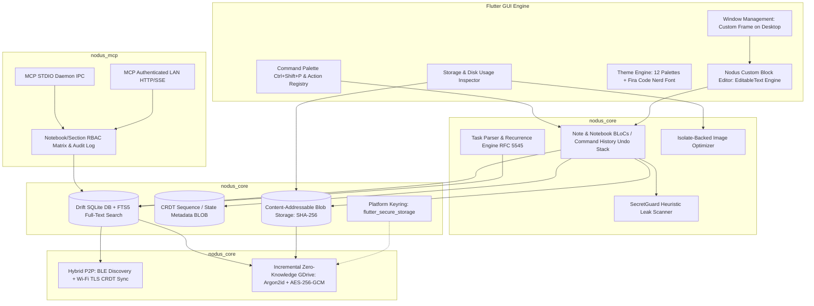

# Nodus — Architecture & Technical Specification

> **Project Name:** Nodus (*Latin for node, connection, or intersection*)  
> **Status:** Architecture Approved / Ready for Phase 1 Execution  
> **Target Audience:** Software Engineers, DevOps/SREs, Network Architects, Cybersecurity Professionals  
> **Platforms:** Linux, Windows, macOS, Android, Web (iOS-ready)  
> **License:** Open Source (Recommended: AGPL-3.0 or Apache 2.0)  

---

## 1. Executive Summary & Vision

**Nodus** is a cross-platform, local-first, serverless technical workspace and note-taking application. It combines:
* The structured, hierarchical organization of Microsoft OneNote (Notebooks -> Sections -> Pages -> Subpages).
* The developer and hacker ergonomics of Zed and Obsidian (Nerd Fonts, terminal logs, code blocks, ASCII diagrams, command palette).
* The zero-configuration sync and cloud backup model of WhatsApp (device-to-device local P2P sync via CRDTs + zero-knowledge client-side encrypted Google Drive incremental backup).
* First-class **Model Context Protocol (MCP)** support via a dedicated CLI daemon/server for secure, granular AI agent interaction (local and remote).
* Zero mandatory centralized infrastructure: all data remains strictly sovereign on the user's local hardware.

> **Project Documentation Rule:**  
> All project specifications, architectural designs, implementation plans, and technical markdown documents must **always** be placed inside the organized [`docs/`](./docs) directory in the project root. No loose markdown or temporary planning files should ever be placed elsewhere.

---

## 2. Core Architectural Pillars & Workspace Modularization

To ensure the CLI MCP server and future headless tools can operate completely independently of the Flutter GUI engine, Nodus is engineered as a **modular Dart monorepo workspace**:

```
nodus/                               # Monorepo Root (Flutter Application)
├── packages/
│   ├── nodus_core/                  # Pure Dart: Entities, Drift DB, CAS, CRDT state,
│   │                                # Use Cases, SecretGuard, Task Parser, Crypto
│   └── nodus_mcp/                   # Standalone Dart CLI: nodus-mcp-server executable
│                                    # (STDIO & authenticated LAN HTTP/SSE transports)
├── lib/                             # Flutter GUI Presentation Layer (imports nodus_core)
│   ├── core/                        # UI DI, Routing, Window Management, Themes
│   └── features/                    # BLoCs, Custom Block Editor Canvas, Split Views, HUD
└── test/                            # Unit, Widget, Golden, & Integration Test Suites
```



---

## 3. Custom Block Editor Architecture & Data Model

Rather than retrofitting standard rich-text web wrappers, Nodus implements a **purpose-built, high-performance block-based editor** built directly on top of Flutter's `EditableText` and `TextEditingController` primitives.

### 3.1 Block Schema & Storage Representation
* **Single SQLite Table with Polymorphic Freezed Sealed Types:**
  All blocks belong to a single `note_blocks` table in Drift:
  ```sql
  CREATE TABLE note_blocks (
    id TEXT PRIMARY KEY NOT NULL,
    page_id TEXT NOT NULL REFERENCES pages(id) ON DELETE CASCADE,
    block_type TEXT NOT NULL, /* heading, text, code, terminal, image, task, diagram, secret_vault */
    sort_order REAL NOT NULL, /* Fractional indexing for O(1) reordering */
    content TEXT NOT NULL,    /* JSON-encoded type-specific payload */
    crdt_state BLOB,          /* Yjs/CRDT binary delta for real-time conflict-free merge */
    created_at_hlc TEXT NOT NULL, /* Hybrid Logical Clock timestamp */
    updated_at_hlc TEXT NOT NULL
  );
  CREATE INDEX idx_blocks_page_sort ON note_blocks(page_id, sort_order);
  ```
* **Domain Model:** Defined as Dart 3 `sealed class NoteBlock` with Freezed union variants (`TextBlock`, `CodeBlock`, `TerminalBlock`, `ImageBlock`, `TaskBlock`, `DiagramBlock`, `VaultBlock`).

### 3.2 Editing, Focus & Keyboard Ergonomics
* Each block maintains an independent `FocusNode` and `TextEditingController`.
* **Keyboard Navigation:**
  * `Enter` at the end of a block creates a new matching block immediately below.
  * `Backspace` on an empty block deletes the block and moves focus to the previous block.
  * `Up` / `Down` arrow keys navigate seamlessly across block boundaries.
  * Slash command menu (`/code`, `/term`, `/table`, `/img`, `/task`, `/diag`, `/vault`) triggers an in-place conversion popup.
* **Undo/Redo Strategy:**
  * Linear undo/redo stack per page inside `PageEditorBloc`.
  * Implemented via a reversible `CommandHistory` pattern (`EditContentCommand`, `InsertBlockCommand`, `DeleteBlockCommand`, `ReorderBlockCommand`).
* **Persistence & Auto-Save:**
  * Debounced auto-save (1–2 seconds idle) + immediate synchronous flush on blur, block reorder, or page navigation.
  * Persisted in a single atomic SQLite transaction writing dirty blocks only.

---

## 4. Storage Management, Attachments & Image Compression

Technical note-taking often accumulates heavy files: screenshots, architecture diagrams, packet captures (`.pcap`), and configuration archives. Nodus keeps the database blazing fast while giving users complete storage visibility.

### 4.1 Content-Addressable Storage (CAS)
* Binary attachments are stored on disk in `.nodus/blobs/<sha256_hash>` rather than inside SQLite.
* SQLite stores only metadata: `hash`, `original_name`, `mime_type`, `byte_size`, `created_at`, and `note_reference_count`.
* Deduplication is automatic: identical images or files pasted across multiple notes share the exact same on-disk blob.

### 4.2 Storage Breakdown Dashboard
* An integrated **Disk Usage & Storage Inspector** displays:
  * Overall space consumed by Nodus.
  * Breakdown by file type: Images, Documents, Binaries/PCAPs, Text.
  * Largest attachments list with quick links to the enclosing notes.
  * **Orphan Cleaner:** One-click detection and removal of unreferenced blobs (e.g., deleted images from discarded notes).

### 4.3 Built-in Image Compression Engine
* **Isolate-Backed Compression (Phase 1 Pure Dart `image` package):**
  * Spawns a background Dart isolate to prevent UI thread lag when downscaling or encoding heavy images.
  * Automatically downscales high-DPI screenshots (e.g., max 1920px width) while maintaining sharp font contrast for code readability.
  * Manual or clipboard auto-conversion to optimized WebP format.
  * Modular FFI hooks reserved for native `libwebp` acceleration in future phases if profiling demands.

---

## 5. Curated Themes, Typography & Window Experience

Nodus uses a high-density, technical UI framework ("Carbon HUD"). Users can switch between dark and light modes with zero restart:

### 5.1 Platform-Adaptive Window Management
* **Desktop (Linux, Windows, macOS):**
  * Integrated with `window_manager` for a seamless custom borderless frame.
  * Custom title bar integrated with breadcrumbs (`Notebook > Section > Page`), sync indicators, search trigger, and theme-matched window controls (minimize, maximize, close).
* **Mobile & Web:**
  * Uses standard native platform window chrome with responsive drawer layouts.

### 5.2 Command Palette & Action Registry
* Built on Flutter's `Actions` and `Shortcuts` framework.
* `Ctrl+Shift+P` (or `Cmd+Shift+P` on macOS) summons a floating VS Code / Zed-style fuzzy search palette.
* Instant access to: switch themes, create notebook/page, search workspace, export notes, trigger orphan cleanup, toggle view/edit mode.

### 5.3 Dark Themes
1. **Hack The Box (Default):** Deep slate (`#0F1923`), dark navy (`#1B2738`), terminal neon green (`#9FEF00`), threat red (`#FF3E3E`).
2. **Tokyo Night:** Modern, deep blue-indigo aesthetic (`#1A1B26`, `#7AA2F7`).
3. **One Dark Pro:** The classic Atom / VS Code palette (`#282C34`, `#61AFEF`).
4. **Catppuccin Mocha:** High-contrast soothing pastel-dark palette (`#1E1E2E`, `#CBA6F7`).
5. **Dracula:** Vibrant Gothic purple and cyan (`#282A36`, `#BD93F9`, `#50FA7B`).
6. **Nord:** Arctic, calm, north-bluish palette (`#2E3440`, `#88C0D0`).
7. **Gruvbox Dark:** Retro groove warm contrast palette (`#282828`, `#EBDBB2`, `#FE8019`).

### 5.4 Light Themes
1. **GitHub Light / Primer:** Ultra-crisp, high-contrast engineering paper theme (`#FFFFFF`, `#F6F8FA`, `#0969DA`).
2. **Catppuccin Latte:** Soft, warm, low-eyestrain pastel light mode (`#EFF1F5`, `#4C4F69`, `#1E66F5`).
3. **Tokyo Night Day:** Clean daylight with cobalt and violet accents (`#E1E2E7`, `#3760BF`).
4. **Solarized Light:** Precision-tuned optical contrast (`#FDF6E3`, `#657B83`, `#268BD2`).
5. **One Light:** Clean, balanced Atom daylight theme (`#FAFAFA`, `#383A42`, `#4078F2`).

### 5.5 Typography & Nerd Fonts
* **Monospace / Code:** Pre-packaged with **Fira Code Nerd Font** (default) with ligatures. Supports user-selected system Nerd Fonts (JetBrains Mono NF, Hack NF, MesloLGS NF) for rich terminal glyphs.
* **Body / Proportional:** **Inter** (default) with dynamic selection from Google Fonts or local system fonts.

---

## 6. Code Blocks, Terminal Logs & Security Guardrails

### 6.1 Shell Command & Terminal Output Architecture
1. **Shell Command Blocks:**
   * Syntax highlighting for `bash`, `zsh`, `sh`, `fish`, and `powershell`.
   * **Smart Copy:** One-click copy that automatically strips prompt prefixes like `$ `, `# `, `PS >`, or `root@host:~#`.
2. **Terminal Output / Console Log Blocks:**
   * **ANSI Escape Code Engine:** Directly parses and renders ANSI 16-color / 256-color escape sequences from command outputs (e.g., `nmap`, `curl -v`, `gcc`, `pytest`, `docker build`).
   * Monospace horizontal scroll with sticky line numbering and exit code badges (`Exit 0`, `Exit 137`).
3. **General Programming Languages:**
   * Highlighting for Python, Go, Rust, C/C++, TypeScript, Dart, SQL, YAML, JSON, Terraform/HCL, and Dockerfiles.

### 6.2 Built-in Secret & Credential Leak Guard ("SecretGuard")
* Synchronous, debounced regex scanner running alongside the auto-save cycle.
* Evaluates **only dirty/changed blocks** for sub-millisecond execution without UI frame drops.
* Identifies:
  * AWS Access Keys (`AKIA...`), SSH private keys (`-----BEGIN ... PRIVATE KEY-----`).
  * GitHub Personal Access Tokens (`ghp_...`), JWT tokens, Slack/Discord webhooks, generic API secret patterns.
* **Action:** Prompts the user: *"Sensitive token detected: Mark as Vault Secret or Redact?"*
* If marked as a Vault Secret, it is encrypted with a secondary key and hidden from MCP AI agents and unauthenticated previews.

---

## 7. Model Context Protocol (MCP) Integration

Nodus implements a secure MCP server allowing external AI agents (Claude Desktop, Cursor, Antigravity, local Ollama/LangChain agents) to safely read and edit notes without requiring the GUI app to be active.

### 7.1 Standalone CLI Daemon Architecture
* Packaged as an independent executable (`nodus-mcp-server`) compiled from `packages/nodus_mcp`.
* Communicates directly with the same underlying SQLite Drift database using multi-process WAL mode (`PRAGMA journal_mode=WAL;`).
* **Transport Modes:**
  * **Mode A: STDIO Transport (Default & Maximum Security):** Spanned directly by AI agent parent processes via sub-process IPC. Zero open network sockets.
  * **Mode B: Remote / Network HTTP/SSE (Configurable for LAN AI Nodes):** Optional bind to LAN IP with **256-bit Cryptographic Bearer Token Authentication** and subnet whitelisting.

### 7.2 Granular Administration Matrix
* **Per-Notebook & Per-Section Access Control:**
  * `Full Access (Read/Write)`
  * `Read-Only Context`
  * `Air-Gapped / Blocked` (Invisible to MCP)
* **Real-time Audit Log:** Persisted log storing timestamp, agent identity, requested note, and diff changes.

---

## 8. Diagramming Strategy

* **Phase 1: Node-Graph Canvas (Network & System Topologies)**
  * Native Flutter `InteractiveViewer` + `CustomPainter` canvas.
  * Drag-and-drop hardware/cloud nodes (Firewall, Switch, Subnet, Router, Server, Kubernetes Pod, Database).
  * Orthogonal and Bezier connector lines with protocol/port labels.
* **Phase 2: Custom Raw ASCII Diagram Engine**
  * Grid-based character canvas for drawing boxes, tables, and directional flowcharts (`┌───┐`, `│   │`, `└───►`).
  * Export directly into raw text blocks, rendering identically across any terminal, pager, or text editor.

---

## 9. Storage, Synchronization & Cloud Backup

### 9.1 Local Storage, CRDT-Readiness & FTS5 Search
* **Database Engine:** SQLite managed via `drift` with `sqlite3_flutter_libs` in WAL mode.
* **CRDT-Ready Schema:** All `note_blocks` include `crdt_state` binary payload fields and Hybrid Logical Clock (`HLC`) timestamps. This ensures seamless migration to full P2P collaborative synchronization without schema redesign.
* **Denormalized FTS5 Search:**
  * Dedicated `pages_fts` virtual table indexing `title`, `body_text`, `tags`, and `code_snippets`.
  * Updated automatically in the background on page auto-save debounce.
  * Weighted BM25 ranking (e.g., matching titles weighted 5.0x, tags 3.0x, content 1.0x).
* **Tombstone Deletes:** Soft-deletion flag (`deleted_at_hlc`) to prevent split-brain resurrection across offline devices.

### 9.2 Incremental Zero-Knowledge Google Drive Backup (WhatsApp Model)
* Client-side OAuth 2.0 with PKCE targeting the hidden `drive.appdata` folder.
* **Key Derivation & Encryption:** Argon2id key derivation from master passphrase + AES-256-GCM envelope encryption.
* **Incremental Manifest Protocol:**
  * Instead of uploading massive full database snapshots, Nodus maintains an encrypted `manifest.json.enc` on Drive listing all page hashes and blob identifiers.
  * Only new or updated page blocks and CAS blobs are uploaded.
  * GFS (Grandfather-Father-Son) retention (7 daily, 4 weekly, 3 monthly) rotates lightweight encrypted point-in-time manifest checkpoints, enabling instant historical rollbacks with minimal bandwidth and storage overhead.

### 9.3 P2P Synchronization
* **Discovery & Handshake:** BLE advertising/scanning or QR code exchange with Diffie-Hellman ephemeral keys.
* **High-Speed Payload Transfer:** Local Wi-Fi / mDNS via TLS-encrypted TCP sockets or WebRTC DataChannels exchanging CRDT deltas.

---

## 10. Task Engine & Future Productivity Modules

### 10.1 Dual-Write Inline Task Model
Nodus uses an inline authoring syntax that provides the speed of plain text combined with relational querying:
```markdown
- [ ] Configure reverse proxy @due(2026-11-01 14:00) @priority(high) @status(in_progress) @estimate(4h) @start(2026-10-28) @recur(FREQ=WEEKLY) #devops
```
* **Dual-Write Architecture:**
  * The `NoteBlock` text content remains the human-readable visual source of truth.
  * An automated parser extracts task attributes on auto-save debounce and populates a dedicated relational `tasks` Drift table with foreign keys referencing `block_id` and `page_id`.
  * Allows querying tasks across all notebooks (e.g., "All high-priority tasks due this week") without scanning note text at query time.
* **Local Notifications:** RFC 5545 recurrence engine with platform-native notifications (DBus on Linux, WinRT on Windows, NSUserNotification on macOS, AlarmManager on Android).

### 10.2 Future Phases Roadmap: Kanban Board, Gantt Chart & Export Suite

To support complex engineering sprints, network rollouts, and multi-team technical projects, future phases will introduce first-class visual task workspaces directly fed by the relational `tasks` table:

#### A. Interactive Kanban Board View
* **Board Modes:**
  * View tasks grouped by **Status** (`Todo`, `In Progress`, `Blocked`, `Done`), **Priority** (`Urgent`, `High`, `Medium`, `Low`), or **Tags/Sections**.
* **Drag-and-Drop Synchronization:**
  * Dragging a card across columns updates the underlying relational record and immediately rewrites the `@status(...)` attribute in the source note block.
* **Scope Selectors:** Single-page board, Section board, Notebook board, or Global workspace board.

#### B. Gantt Chart & Timeline View
* **Timeline Visualization:**
  * Displays tasks on an interactive chronological timeline utilizing `@start(...)`, `@due(...)`, and `@estimate(...)` metadata.
  * Dependency tracking via `@depends_on(task_id)` allowing critical-path analysis and dependency line connectors.
  * Milestone markers (`@milestone`) for major release targets or architecture sign-offs.
  * Zoom levels: Day, Week, Month, Quarter.

#### C. Comprehensive Task & Project Export Suite
* **Export Formats:**
  1. **Mermaid Gantt Syntax (`gantt`):** One-click copy/export of project timelines directly into standard Markdown Mermaid blocks for documentation and Git PRs.
  2. **iCalendar (`.ics`):** Export tasks and recurring reminders to Google Calendar, Apple Calendar, or Outlook.
  3. **Structured CSV & JSON:** Machine-readable task and estimate exports for spreadsheet modeling or Jira/Linear ingestion.
  4. **OPML / MS Project XML:** Export hierarchical task breakdowns into standard project management tools.
  5. **Clean Markdown Summary:** Render an executive progress checklist with completion percentages.

---

## 11. Next-Gen Desktop Enhancements

1. **LaTeX / KaTeX Equation Support:** Render cryptographic formulas and algorithms.
2. **Hex / Memory Dump Viewer Block:** Fast hex viewer (`Offset | Hex Bytes | ASCII`) for payload analysis and packet inspection.
3. **Desktop Global Quick-Capture:** A system-wide shortcut (`Ctrl+Shift+Space`) summoning a floating borderless scratchpad.
4. **Multi-Window Support on Desktop:** Pop out reference notes onto secondary monitors.
